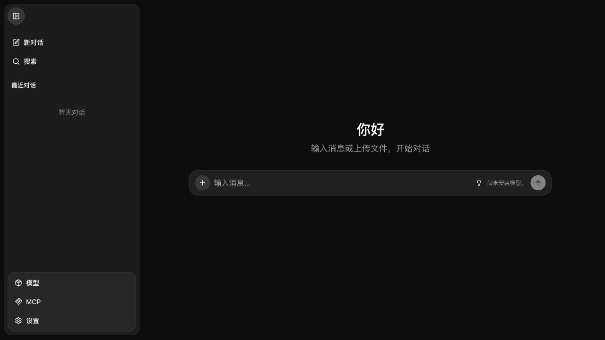

# 🦙 Llama 中文补丁

给 Llama 换张中文面孔。汉化 macOS 网页聊天中的**对话、设置、模型管理和常用提示**。

**[下载中文补丁包](https://github.com/W0gdx/llama-ui-zh-macos/releases/download/v1.0.0-b12375/Llama-zh-CN-b12375-v1.0.0.zip)**

## 三步用上中文

1. 安装并启动 [官方 Llama macOS 应用](https://github.com/ggml-org/Llama-macOS)。
2. 解压补丁包，双击 **启用中文界面.command**。
3. 打开 [本地聊天页面](http://127.0.0.1:9931/)，开始使用。

**恢复原版：**双击 **恢复原界面.command**。启用或恢复时，请先等当前回复生成结束。

仍显示英文？刷新页面；看到 **Update available** 时点击 **Reload**。

## 适配与更新

仅适配 **b12375**，官方更新前请先恢复原版。

## 来源与致谢

- [llama-ui-zh](https://github.com/6667084/llama-ui-zh)：复用已有翻译，适配新版组件。
- [MarioMakeChat](https://github.com/wenbofeng/MarioMakeChat)：中文措辞参考。

两者均采用 MIT 许可，原版权与许可已保留。本项目是非官方适配。详见 [来源说明](ATTRIBUTION.md)。

[源码构建与验收](docs/开发与验收.md) · [MIT 许可证](LICENSE) · [反馈问题](https://github.com/W0gdx/llama-ui-zh-macos/issues)
